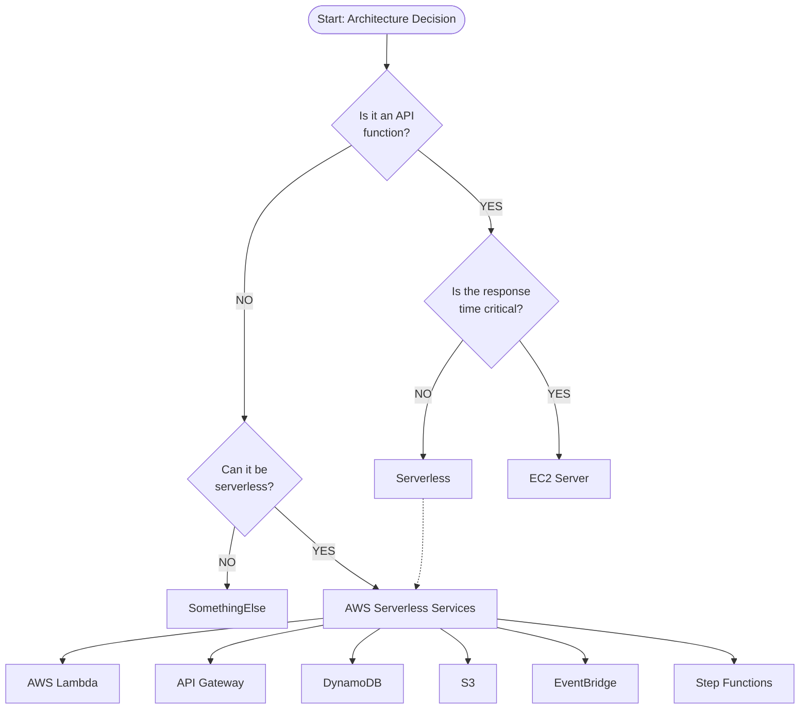

## Decision Flowchart

## Rules

| # | Rule | Rationale |
|---|------|-----------|
| 1 | Customer-facing APIs needing fast response + no heavy ops → **always-on server (EC2/ECS)** | Predictable low latency; avoids cold starts |
| 2 | All other functions → **Lambda** | Pay-per-use, auto-scales, zero ops |
| 3 | Databases, queues, streams, storage → **serverless** (DynamoDB, SQS, Kinesis, S3) | Managed, scales automatically |
| 4 | **Periodic cost re-evaluation** as traffic becomes predictable | RI/Savings Plans may beat on-demand at scale |

## Service Mapping

| Need | Serverless Option |
|------|-------------------|
| Compute | Lambda, Fargate |
| API | API Gateway (REST/HTTP/WebSocket) |
| Database | DynamoDB, Aurora Serverless v2 |
| Queue/Stream | SQS, SNS, EventBridge, Kinesis |
| Storage | S3, EFS (with access points) |
| Orchestration | Step Functions |
| Auth | Cognito, IAM |

## When to Reconsider (Cost Optimization Triggers)

| Signal | Action |
|--------|--------|
| Lambda duration > 50% of max timeout consistently | Profile, optimize, or move to Fargate/EC2 |
| Monthly Lambda cost > equivalent EC2/Fargate reserved | Calculate break-even; consider Savings Plans |
| Predictable, steady traffic (>50% utilization 24/7) | EC2/ECS with Savings Plans |
| Cold starts impact p99 latency | Provisioned Concurrency or keep-warm |

## Related

- [AWS Lambda Performance Best Practices](/posts/lambda-performance-best-practices/) — Once you have picked Lambda, make it fast
